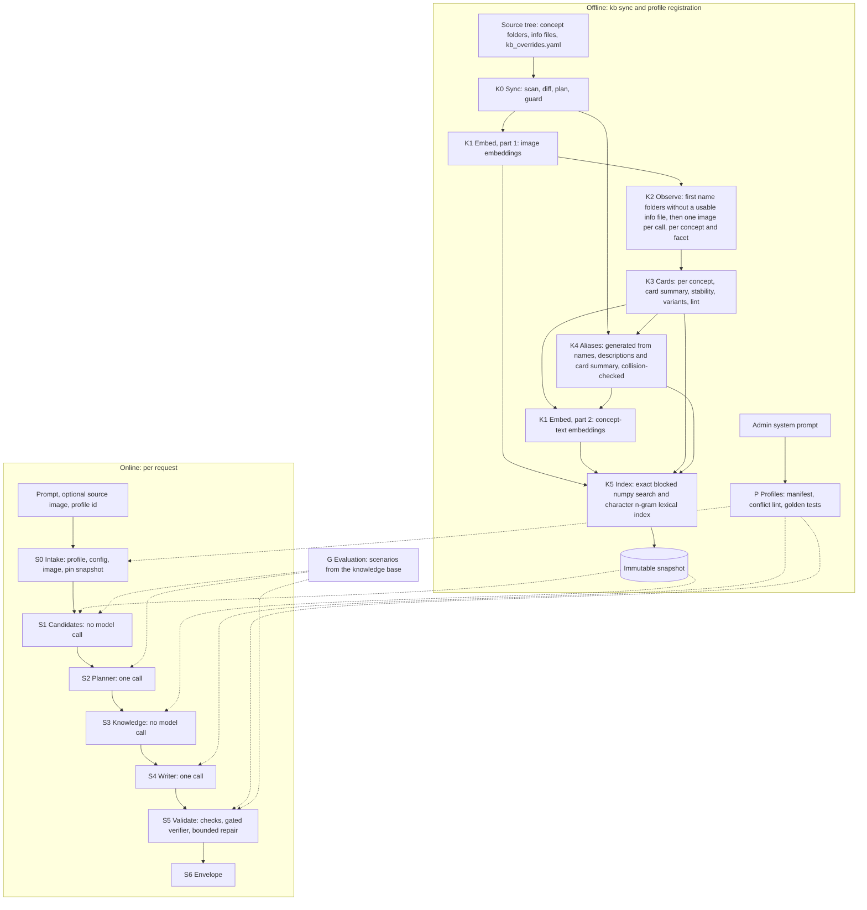

# Architecture: prompt enhancer with a concept knowledge base

Source: the PM's design specification v2.2 ([N000](note/N000-design-provenance.md)), as settled by the user's decisions 1 to 27 ([DECISIONS_INDEX](../tasks/DECISIONS_INDEX.md)). Requirements: [R-IDs](../tasks/REQUIREMENTS.md). Items tagged **[P]** are PM proposals and **[A]** are assumptions; each has an experiment in [G-evaluation](stages/G-evaluation.md). Nothing is implemented and nothing is measured; every unmeasured value is a sentinel.

## Goal

Take a user's text prompt (task `generate`) or a text prompt plus one source image (task `edit`) and write an enhanced prompt or edit instruction for a downstream image model, in the style and output format the admin's system prompt defines (R-002, R-004). With retrieval on, add correct knowledge about the concepts the user named, taken from a knowledge base of concept folders with images (R-007), and only where the user left the content open (R-012). The enhancer writes text; it never renders or edits pixels.

## Principles

1. **The user's intent survives (R-001).** Identities, counts, attributes, relations, negations, style and text to be rendered come through unchanged; every one becomes an entry of the constraint ledger and is checked in [S5](stages/S5-validate.md).
2. **Work that does not depend on the request runs offline (R-010).** Images are read, cards built and aliases generated by `kb sync`, so a request reads cached knowledge instead of reading knowledge-base images.
3. **Models decide meaning; code applies policy (R-015).** The planner says which concept a mention refers to and what role it plays; the scope matrix, the user's locks, budgets and the random pick are code and configuration.
4. **The writer sees only what it may use (R-012).** Out-of-scope facts are removed before the writer runs, so it has nothing to leak ([S3](stages/S3-knowledge.md)).
5. **Knowledge is data, never instructions (R-026).** Knowledge-base text, text read from images and captions sit in delimited data blocks, never in the instruction position.
6. **The admin's system prompt is never edited (R-004).** Anything the pipeline adds is a versioned runtime addendum that appears in the trace.
7. **No hand-written content rules and no guessed thresholds (R-015).** Cross-language matching comes from model-generated aliases and embeddings; values not yet measured hold sentinels.
8. **The knowledge base is managed and columnar (R-014, R-016, R-017).** `kb sync` is the only writer, every artifact is Parquet or Arrow keyed by content plus revisions, and the serving index is rebuilt per immutable snapshot.
9. **Retrieval off is structural (R-009).** With `rag.enabled: false` the knowledge gateway is never constructed, so no request can touch the knowledge base ([execution](execution.md#retrieval-off-is-structural)).
10. **One explicit status per response (R-024).** A truncated or failed output is never `success`; the output payload carries no citations, warnings or debug fields.

## Run paths

| Path | S1 candidates | S2 planner | S3 knowledge | S4 writer | Model calls online (design, not measured) |
| --- | --- | --- | --- | --- | --- |
| `generate`, retrieval on | runs | text only, with shortlist | runs | text only | planner, writer; verifier when gated in |
| `edit`, retrieval on | runs | sees the source image | runs; may add `attach` images when configured (decision 14) | sees the source image | planner, writer, verifier |
| retrieval off (either task) | not in the graph | no shortlist, no concept links | not in the graph | no knowledge block | planner, writer; verifier when gated in |

A repair adds one writer call and one verifier call per round. On the path without knowledge, merging planner and writer into one call is experiment E6, not the default, because it loses the separate constraint ledger.

## Flow

| Stage | Document | Runs on | Output |
| --- | --- | --- | --- |
| K0 | [sync](stages/K0-sync.md) | CPU | `sync_state`, plan, new snapshot, `snapshots` row |
| K1 | [embed](stages/K1-embed.md): image part after K0, concept-text part after K3 and K4 | GPU | `images`, `image_embeddings`; later `concept_text_embeddings` |
| K2 | [observe](stages/K2-observe.md) | HTTP to the `observer` backend | `observations` |
| K3 | [cards](stages/K3-cards.md) | CPU, HTTP to the `card_builder` backend | `cards`, lint report |
| K4 | [aliases](stages/K4-aliases.md) | HTTP to the `alias_generator` backend | `aliases` |
| K5 | [index](stages/K5-index.md) | CPU | serving index per snapshot |
| P | [profiles](stages/P-profiles.md) | HTTP to the `manifest_drafter` backend, admin | profile manifest, conflict decisions, golden results |
| S0 | [intake](stages/S0-intake.md) | CPU | effective configuration, pinned `snapshot_id`, prepared image |
| S1 | [candidates](stages/S1-candidates.md) | CPU, short text embedding | shortlist |
| S2 | [planner](stages/S2-planner.md) | HTTP to the `planner` backend | Intent IR, concept links, constraint ledger |
| S3 | [knowledge](stages/S3-knowledge.md) | CPU | Knowledge Pack |
| S4 | [writer](stages/S4-writer.md) | HTTP to the `writer` backend | draft output |
| S5 | [validate](stages/S5-validate.md) | CPU, HTTP to the `verifier` backend | checked output, status |
| S6 | [envelope](stages/S6-envelope.md) | CPU | response envelope, `request_traces` row |
| G | [evaluation](stages/G-evaluation.md) | agents, `scenario_generator` backend, user review | `eval_scenarios`, `eval_labels`, `eval_results`, fitted values |

## Why this order [P]

Offline order: K0; K1 image embeddings; K2 (its first step judges every info file and names folders that have no usable one, from images drawn at random, because observation needs the concept list); K3; K4 (needs the card summary from K3); K1 concept-text embeddings (the text includes the card summary and the aliases); K5. K1 therefore has two parts, and K4 depends on K0 and K3. Read knowledge-base images offline, one per call, because cross-image leakage and order effects make multi-image reading unreliable and the cost then stays out of request latency ([K2](stages/K2-observe.md)). Generate candidates without a model before the planner, because a shortlist is cheap and the whole catalogue cannot sit in the planner's context ([S1](stages/S1-candidates.md)). Resolve concepts in the same call that parses the prompt, because the role of a mention and whether it is negated are known only once the sentence is understood. Filter knowledge in code before the writer, because filtering is the only guarantee against leakage. Check structure before any verifier call, because structural checks are exact and free.

## Statuses and retrieval states

Every response has one status (`success`, `repaired`, `degraded`, `needs_clarification`, `failed`) and one retrieval state (`disabled`, `skipped_no_knowledge_needed`, `retrieved`, `no_match`, `failed`). The enums and the envelope are defined in [contracts](../contracts/README.md); how they are set is in [S6](stages/S6-envelope.md).

## Out of scope

Rendering or editing pixels; training or fine-tuning any model; captioning the user's own images as a product feature; choosing the downstream image model, which the admin selects through the profile.
